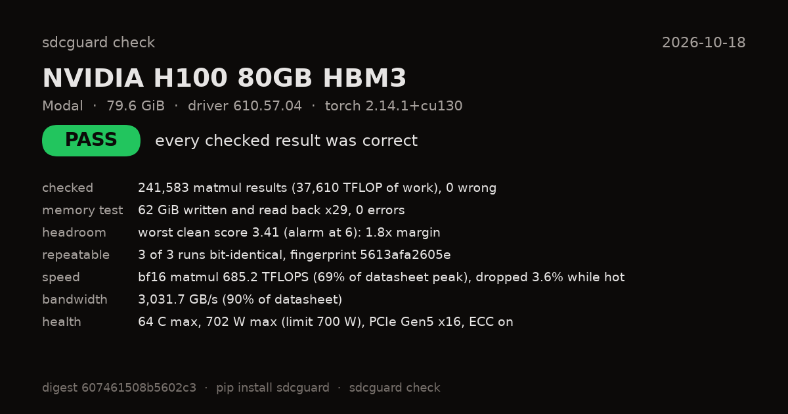
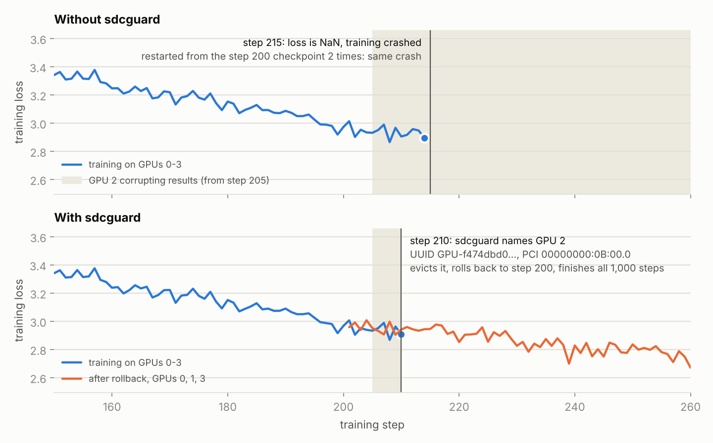

# sdcguard

Catch GPUs that silently compute wrong answers.

Some GPUs go bad without crashing. They keep running and return wrong numbers, and nothing in the logs
tells you. Meta sees this at "about one fault per thousand devices"
([Meta, 2025](https://engineering.fb.com/2025/07/22/data-infrastructure/how-meta-keeps-its-ai-hardware-reliable/)).
In ByteDance's 35 million GPU-hour training deployment, 15 of the 18 incidents they found caused no visible
failure, and the vendor's offline diagnostics caught 2 of 8 known-bad machines
([AEGIS, OSDI '26](https://www.usenix.org/system/files/osdi26-lei.pdf)).

sdcguard checks the math while it runs. Every matrix multiply it checks has to satisfy a cheap checksum
identity, with a noise model so normal bf16/fp16 rounding doesn't set it off. When a result is wrong you get the
GPU (UUID, PCI slot), the layer and where in the output. No replay, no deterministic mode, no framework fork.

## Check a GPU

```bash
pip install sdcguard
sdcguard check            # every GPU on this machine, about 5 minutes
sdcguard check --share    # same, plus a link that posts your result to the public board
```



It trains and serves a small GPT-style model with every matmul checked, runs big matmuls at full power, checks
matmuls in BF16, FP16, TF32, FP32, FP64, INT8 and FP8 (whichever the GPU supports) against a float64 answer from
the CPU, pattern-tests most of the free memory, measures speed against the datasheet, and runs one fixed model
three times to see if the output stays bit-identical. The math modes matter because a bad GPU can get one
wrong and the rest right: in ByteDance's study, four GPUs that got matrix multiplies wrong all passed BF16 and
FP16 ([SDCs in the Wild, OSDI '26](https://www.usenix.org/system/files/osdi26-zheng.pdf)). The verdict is
PASS, FAIL (wrong results; the failed matmuls' inputs and outputs are saved so `sdcguard replay` can recompute
them on another GPU), SUSPECT (no checksum failed, but output that should repeat exactly didn't) or
INCOMPLETE (nothing wrong was found, but part of the check couldn't run or couldn't judge its results). Handy
before a long run on a rented GPU, before buying a used one, or after overclocking.

Shared results go on the [board](https://hari-kancharla.github.io/sdcguard/board/), by GPU model and
provider. It starts with 10 cloud GPUs (B200, H200, two H100s, A100, L40S, three L4s, T4 on AWS, Google
Cloud, Azure and Oracle machines): all PASS, 1.68 million results checked, and GPUs of the same model gave
bit-identical output on different machines and clouds.

## No GPU? Try the demo

```bash
python -m sdcguard.demo       # a device goes bad mid-training and gets caught
python -m sdcguard.selftest   # checks that sdcguard works on this machine
```

Or run it in [Colab](https://colab.research.google.com/github/hari-kancharla/sdcguard/blob/main/examples/colab_demo.ipynb).
Here's what it looks like on 4 H100s:

<picture>
  <source media="(prefers-color-scheme: dark)" srcset="docs/img/demo_zoom_dark.png">
  
</picture>

Logs and raw numbers: [results/demo_4gpu](results/demo_4gpu).

## In training

```python
from sdcguard import SDCGuard

guard = SDCGuard(every=20).protect(model)    # checks every nn.Linear: forward, dX and dW
for step, (x, y) in enumerate(loader):
    with guard.on_step(step):                # only every 20th step is checked
        loss = model(x, y); loss.backward()
    optimizer.step(); optimizer.zero_grad()
    if guard.log.events:                     # pull the GPU, roll back
        print(guard.log.events[0].to_json()); break
```

On an H100, checking every 20th step costs 1.7% on GPT-2 small and 1.3% on a 0.9B model. The checks only
read; with `exact_reductions=False` the gradients are bit-identical to a run without sdcguard (one exception:
a protected layer's weight also used directly by another op in the same autocast region, where the two uses
get separate bf16 copies of the weight).

## In serving (vLLM, Hugging Face)

```bash
SDCGUARD=1 SDCGUARD_SHARE=0.125 vllm serve Qwen/Qwen2.5-7B-Instruct
```

`SDCGUARD_SHARE=0.125` checks one linear layer in eight, spread over every kind of layer and depth. In
vLLM's offline benchmark with Qwen2.5-7B on an H100 that cost 3% of throughput (22,612 vs 23,294 tokens/s) and the answers compared were
word for word the same as plain vLLM's. Checking every layer cuts throughput by 22% for now. Weight checksums are computed
once at load, so weights that get corrupted in GPU memory later are caught too.

Any PyTorch model:

```python
from sdcguard.serve import ServeGuard

guard = ServeGuard().attach(model, share=0.125)   # bf16 or fp16 model on its GPU
...                                                # serve as usual, eager or torch.compile
for event in guard.poll():                         # never stalls the GPU
    print(event.to_json())
```

## Across a fleet

```bash
sdcguard screen --minutes 10                         # screen every GPU on the node
sdcguard replay screen_out/GPU-.../evidence_0.pt     # recompute a failure on another GPU
sdcguard report node*/sdcguard_check --out fleet_report
```

A failed training, stress or math-mode check saves the matmul's inputs and the wrong output with the GPU's
UUID, serial and PCI slot: the kind of evidence NVIDIA's RMA process asks for when its own diagnostic passes
(a replay that fails again points at the GPU; it doesn't rule out a software cause on its own). Serving alerts
name the layer and position but don't save the inputs. `sdcguard nhc` is a node
health check for Kubernetes node-problem-detector and Slurm ([deploy/](deploy/)). `sdcguard keygen` plus
`sdcguard check --key` gives each GPU a signed certificate, for handing GPUs between a provider and a
customer. While serving, alerts can go to a Slack or Discord webhook or to Prometheus.

## How it works

For `C = A @ B`, the sum of each block of 128 output columns has to equal `A` times the matching column sums
of `B`. Both sides are cheap, so a wrong value in `C` shows up as a mismatch. This is algorithm-based fault
tolerance (Huang and Abraham, 1984). Each block gets a plain sum and a randomly signed one, so most errors that
cancel in one show in the other. Not all: two outputs of a block swapped where the signs match cancel in both.
So `check` draws fresh sign patterns for every matmul it tests, and training checks take a new pattern every
checked step; a fault that keeps swapping the same two outputs then shows on about half the checked steps
instead of never. Serving computes its weight checksums once at load, so it keeps one pattern.

bf16 results are rounded, so the two sides never match exactly. sdcguard estimates each block's rounding
noise and only alarms past 6 times that. In 24.6 million checks over 5 GPU-hours of clean training (Oct 14-15,
the default mode of that version) it never false-alarmed (worst score 3.54); the board sweep with every phase of
`check` added 1.68 million more on 10 GPUs (Oct 18, worst 3.67). The trade-off: errors under about 1% of a block hide in the noise. On NVIDIA
GPUs the checks run as Triton kernels, which first have to match the plain PyTorch check or the plain check
is used instead. Serving reads results back without stalling the GPU; training reads them once at the end of
each checked step.

A recent real case of this kind: on NVIDIA's forum on Oct 2, 2026, a user reported that on H200s shared
through MPS, some cuBLASLt kernels report success but leave part of the output unwritten, with no error and no
Xid ([thread](https://forums.developer.nvidia.com/t/384873), [repro](https://github.com/Yeosangho/mps-cublaslt-fp16-corruption-repro)).
NVIDIA reproduced it on Oct 6. It's a software bug, not a bad GPU, but it looks the same from the outside.
We reproduced it on an H200 on Modal on Oct 19 ([results](results/mps_bug)): with MPS limiting the process to
14%, 40% or 75% of the SMs, the reported layer (16x2048x1000) computed wrong forward outputs or weight
gradients, and the training check raised an alert at each of those shares; at 50% and 100% it computed
correctly. At 20% every output was right, but the check still alerted: the bug had hit the check's own matmul. Each saved evidence file now includes a
recheck on the CPU that tells the two apart ("the output was wrong" or "the check's own GPU arithmetic was").
[tests/test_unwritten_output.py](tests/test_unwritten_output.py) emulates the reported pattern on CPU.

It also holds up against faults injected into real hardware. Flipping a mantissa bit in every tensor-core
instruction on one lane of an L4 (about a 10% error in one input) left the loss untouched, and sdcguard
flagged 30 of 30 steps and named the layer ([results](results/round3_oct18/nvbit)).

## What it covers

| | |
|---|---|
| Works | PyTorch training in bf16/fp16 (DDP tested on 4 H100s, FSDP2 on CPU), Hugging Face and vLLM serving, `sdcguard check` on B200, H200, H100, A100, L40S, L4 and T4 |
| Not checked | fp32/TF32 and quantized (FP8, INT4) matmuls in training and serving (`check` tests fp32, TF32 and FP8 one matmul at a time), convolutions, fused MoE experts, vLLM's LM head, the inside of fused attention (only `check`'s repeatability test covers it), `nn.MultiheadAttention`'s output projection and `nn.TransformerEncoderLayer`'s fused inference path (both listed as unchecked, not reported as checked) |
| Not supported on checked steps | `torch.func` transforms (vmap, grad) and `torch.compile(fullgraph=True)`: fast mode runs checked steps' linear layers eagerly |
| Not tested yet | Megatron tensor/pipeline parallel, DeepSpeed, multi-node, AMD, Apple GPUs (only the operator mapping is unit-tested) |

On Blackwell (B200) sdcguard uses the plain PyTorch checks; the faster Triton kernels cover Turing through
Hopper for now.

## More

- [docs/METHOD.md](docs/METHOD.md): how every number here was measured, with the pass/fail criteria written
  before the GPU runs
- [docs/WHY.md](docs/WHY.md): what already exists (DCGM, gpu-burn, TorchTitan's replayer, AEGIS and others)
  and what it misses
- [results/](results/): raw output of every GPU run
- To reproduce: `pip install -e ".[experiments,dev]" && pytest -q`, then the Modal scripts in
  [scripts/](scripts/). The full `check` sweep over 7 GPU types costs about $4.40.

## Status

Alpha (0.3.0), MIT license. Built by Hari Krishna Kancharla. Bug reports and results from your own GPUs are
very welcome, most of all from a GPU you think is bad.
