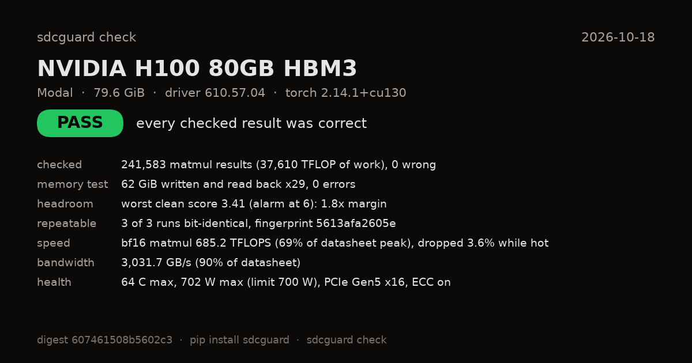
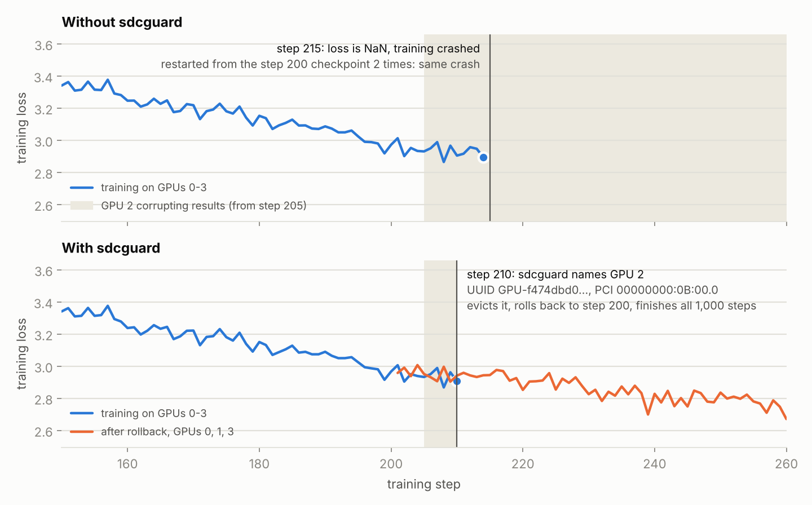

# sdcguard

Hi, I'm Hari. sdcguard catches GPUs that give wrong answers without crashing.

A GPU can return wrong numbers and keep going. No error, no crash, and the loss curve looks fine. Sometimes the
chip is bad, sometimes it's a library bug. Meta sees roughly one faulty device per thousand, and ByteDance
found 18 incidents in 35 million GPU-hours, 15 of them silent
([AEGIS](https://www.usenix.org/system/files/osdi26-lei.pdf)).

The usual health checks test an idle GPU. sdcguard checks the math of your actual training run or vLLM server
while it runs.

## Try it

```bash
pip install "sdcguard[all]"
sdcguard check
```

That takes about five minutes per machine. It runs matmuls in every precision your GPU supports and checks them
against float64, tests memory, trains and serves a small model with the checks on, and makes sure a fixed
model gives the same output every time. Each GPU gets PASS, FAIL, SUSPECT or INCOMPLETE. A FAIL saves the
inputs and the wrong output so you can replay them on another GPU.

Add `--share` to put your result on the [public board](https://hari-kancharla.github.io/sdcguard/board/).

No GPU? `python -m sdcguard.demo` runs a simulated bad GPU on your CPU, or try it in
[Colab](https://colab.research.google.com/github/hari-kancharla/sdcguard/blob/main/examples/colab_demo.ipynb).



## What a bad GPU looks like

Here's a simulated bad GPU: 4 H100s training a 51M-parameter GPT model on TinyStories. From step 205,
GPU 2 corrupts 5% of its attention Q/K matmuls, using the fault patterns from NVIDIA's
[gate-level fault-injection study](https://arxiv.org/abs/2605.04213). sdcguard checked every 10th step,
flagged GPU 2 at step 210, rolled back to the step 200 checkpoint and finished all 1,000 steps on the other
three GPUs (the blue line after step 200 is that rerun). Without it, the loss looked normal until it turned
NaN at step 215, and it crashed the same way after both restarts.

<picture>
  <source media="(prefers-color-scheme: dark)" srcset="docs/img/demo_zoom_dark.png">
  
</picture>

Logs and raw numbers are in [results/demo_4gpu](results/demo_4gpu).

## A real bug that GPU health checks can't see

cuBLAS has a bug (NVIDIA known issue 6862950) that gives wrong FP16, BF16 and FP8 matmuls on Hopper GPUs
running under MPS with less than 100% of the SMs. It was
[reported on NVIDIA's forum](https://forums.developer.nvidia.com/t/cublaslt-returns-silently-wrong-fp16-bf16-fp8-gemm-results-on-hopper-under-cuda-mps-active-thread-percentage-algoid-66-cluster-kernels/384873)
by another engineer on October 2, 2026, and NVIDIA confirmed it on October 6.

I ran sdcguard, DCGM and gpu-burn on one H200 at four MPS shares, with the rules written down before the run.
The second column is the ground truth: PyTorch's own matmuls at that share, checked against float64.

| MPS share | PyTorch's matmuls | sdcguard check | DCGM diagnostic | gpu-burn |
|---|---|---|---|---|
| 100% | right | pass | pass | pass |
| 40% | **wrong** | **FAIL** | pass | pass |
| 75% | **wrong** (weight gradients) | **FAIL** | pass | pass |
| 14% | **wrong** | **FAIL** | pass | pass |

DCGM and gpu-burn were right to pass: their own matmuls, in their own shapes and settings rather than the job's,
came out right every time, so the rules written before the run count them as not exercised, not as misses. That's the point: a test
that runs its own matmuls can't vouch for the ones your job runs. Full rules and logs are in
[METHOD.md](docs/METHOD.md#head-to-head-on-a-real-cublas-bug-written-october-20-2026-before-any-run).

## In training

```python
from sdcguard import SDCGuard

guard = SDCGuard(every=20).protect(model)    # checks every nn.Linear: forward, dX and dW
for step, (x, y) in enumerate(loader):
    with guard.on_step(step):                # every 20th step is checked
        loss = model(x, y); loss.backward()
    optimizer.step(); optimizer.zero_grad()
    if guard.log.events:
        print(guard.log.events[0].to_json()); break
```

In tests on an H100 (October 18), checking every 20th step cost 1.7% on GPT-2 small and 1.3% on a 0.9B model.
It works with autocast,
DDP, FSDP2, tensor parallel and `torch.compile`. With the Hugging Face Trainer it's one line:

```python
trainer = Trainer(..., callbacks=[SDCGuardCallback(every=20, stop_on_alert=True)])   # from sdcguard.hf
```

## In vLLM

```bash
SDCGUARD=1 SDCGUARD_SHARE=0.125 vllm serve Qwen/Qwen2.5-7B-Instruct
```

This checks one linear layer in eight. On Qwen2.5-7B on an H100 it cost at most about 4% of throughput, the
answers were word for word the same as plain vLLM, and a weight bit I flipped on purpose was caught and the
layer named. Checking every layer costs about 30% on the 7B model for now. I'm working on making that cheaper.

When a check fires, sdcguard keeps the exact numbers that failed (copied on the GPU before vLLM reuses the
memory) and rechecks them in float64 on the CPU, so the alert tells you whether the output was really wrong.

For any other PyTorch model there's `ServeGuard().attach(model, share=0.125)`.

## Across a fleet

```bash
sdcguard screen --minutes 10                         # screen every GPU on a node
sdcguard replay screen_out/GPU-.../evidence_0.pt     # replay a failure on another GPU
sdcguard report node*/sdcguard_check --out fleet_report
sdcguard blas                                        # every cuBLAS algorithm on a few shapes, checked
sdcguard issues                                      # which known cuBLAS bugs apply to this machine
```

There are also Kubernetes and Slurm health checks ([deploy/](deploy/)), signed per-GPU certificates, and alerts
to Slack, Discord, Prometheus or NVIDIA NVSentinel.

## How it works

For `C = A @ B`, the sum of each block of 128 output columns has to equal `A` times the matching column sums of
`B`. Both sides are cheap to compute, so a wrong value in `C` shows up as a mismatch. This is algorithm-based
fault tolerance (Huang and Abraham, 1984). The hard part is bf16: normal rounding makes the two sides differ a
little, so sdcguard models each block's rounding noise and only alarms past six times that. In 24.6 million
checks of clean GPT-2 small training on H100s (every matmul on every step, five 62-minute runs on October 14-15,
with the check as it was then) it raised no false alarm; the highest score was 3.54. On NVIDIA GPUs the checks run
as Triton kernels.

## What it can't do yet

- Small errors. Anything under about 1% of a block slips through. ByteDance found its real incidents with
  fp32 checksums, not bf16 ones. The fp32 check (`precise="fused"`) is still experimental.
- Anything outside the checked matmuls: attention internals, norms, the optimizer. The experimental
  `recompute=True` check covers activation-checkpointed blocks in training.
- Quantized layers (FP8, AWQ, GPTQ) and fused MoE experts in vLLM.
- AMD GPUs.
- It hasn't caught a naturally bad GPU yet. So far the evidence is injected faults and the cuBLAS bug above.

## Project layout

```
src/sdcguard/     the library
experiments/      the GPU experiments behind every number here
scripts/          the runners that launch them on cloud GPUs
results/          raw results of every GPU run
docs/             METHOD.md (how each number was measured), EVIDENCE.md, WHY.md, the board
deploy/           Kubernetes, Slurm and Docker
tests/            pytest -q runs them all on a CPU
```

## Feedback

This is alpha (0.4.0), MIT licensed, and I built it on my own. If you try it, I'd love to hear how it went,
and most of all if you have a GPU you think is bad. Open an issue.
