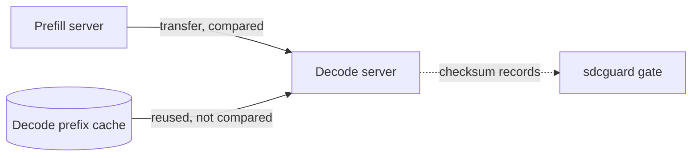

# sdcguard

Release tests for LLM inference servers.

An inference server can send back a wrong answer with a normal HTTP 200. sdcguard shows what the server's own
integrity checks covered for each request, so you can see it before you ship an engine upgrade.

## What I found

I reproduced vLLM bug [#61229](https://github.com/vllm-project/vllm/issues/61229) on an H100. The decode server
reads KV blocks the prefill server already freed and reused, and I forced the timing with a delay. Asked to repeat
the secret word PLUM, one run answered "M. Repeat the secret word..." with a 200. All 8 unfixed runs came back
wrong, and sdcguard flagged the stale read in every one. With the proposed fix
([#62065](https://github.com/vllm-project/vllm/pull/62065)) backported, all 5 replays were right.
[Saved results](results/61229_saved).

Then I tested vLLM's proposed KV checksum ([#62211](https://github.com/vllm-project/vllm/pull/62211), not merged
yet). In a test where requests share most of their prompt, the checksum passed on all 153 requests, but only 9 had
their whole prompt compared. The rest reused cache that was checked once, when it first arrived. That's by design,
and SGLang does the same. But it means a pass doesn't tell you how much of the prompt was checked. I
got the same result on two builds of the PR and posted the numbers there.

## Try it

```sh
git clone https://github.com/hari-kancharla/sdcguard
cd sdcguard
python3 -m venv .venv
. .venv/bin/activate
pip install --no-deps .
sdcguard gate tests/data/checksum_owner_3a2ad847 --require checksum
```

This replays the Oct 30 H100 run on your machine. No GPU needed, just Python 3.10 or newer.

```
HOLD | required: checksum
selected recorded client requests only; no deployment or isolation guarantee
9 / 153 selected requests passed
...
sgc-3a2ad847b9af4c76ae55aee4111c0258-0-1-35-d | HOLD | cached prefix not covered by checksum; checksum:cached prefix not covered by checksum
  Prompt tokens: 1451; transferred tokens checked: 27; decode cache reused unchecked: 1424; prefill cache reused: 1424
```

It exits 2 on HOLD and 0 on a pass. Two more commands replay saved runs:

- `sdcguard transfer-check tests/data/checksum_owner_3a2ad847` checks whether every transfer was compared. It passes.
- `sdcguard transfer-compare tests/data/checksum_owner_9b42f5ab tests/data/checksum_owner_b340ee03` compares two
  builds of the PR. 153 transfers kept their check and 0 lost it. It still exits 2 with HOLD, because the same
  requests stay partly checked.

## How it works



A vLLM plugin records each checksum call and which tokens it compared. `sdcguard gate` matches those records to
client requests offline and passes a request only if its whole prompt was compared. The full method, recording setup
and limits are in [docs/CHECKSUM_GATE.md](docs/CHECKSUM_GATE.md).

## Status

It supports one vLLM setup today: the checksum PR at two pinned commits, prefill and decode on one H100 over NIXL,
with Qwen3-0.6B. Recording a new run still needs that setup prepared by hand. Next is fault injection, then a
self-service setup, then SGLang and a CI gate.

## Earlier work

sdcguard started as a GPU math checker. On a rented H200 split with NVIDIA MPS, it caught wrong results from a
known cuBLAS bug while NVIDIA DCGM and gpu-burn passed, because their tests never ran the broken code path
([head-to-head](results/h2h/h200_20261020_060928.md)). That version is on PyPI as
`pip install sdcguard` (0.4.0).

---

MIT license. Built by Hari Krishna Kancharla.
