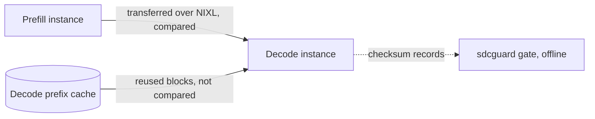

# sdcguard

An open-source release test for LLM inference servers. It records what the engine's own integrity checks verified
for each request, and whether that still holds after an engine upgrade.

An inference server can read the wrong cached data and still return a normal HTTP 200.

## Results

**A wrong answer that came back as a success.** On an H100, I reproduced vLLM bug
[#61229](https://github.com/vllm-project/vllm/issues/61229), where the decode server reads KV blocks the prefill
server has already freed and reused. I forced the timing with a delay. The prompt asked the model to repeat the
secret word PLUM. All 8 unfixed runs returned a wrong answer as a normal HTTP 200. One of them was
"M. Repeat the secret word. Repeat the secret word...".

An earlier sdcguard recorder flagged the stale read in all 8 runs. With the proposed fix
([PR #62065](https://github.com/vllm-project/vllm/pull/62065)) backported, all 5 replays gave the right answer
([saved results](results/61229_saved)).

**What a passing checksum covered.** vLLM has a proposed checksum on the KV data that prefill sends to decode
([PR #62211](https://github.com/vllm-project/vllm/pull/62211), not merged). On Oct 30, 2026, on one H100, it passed
all 153 requests in my test. Only 9 of them had their whole prompt compared during the request.

The test was built around reuse. It sends 9 groups of 17 requests, and the requests in a group share most of their
prompt. The first request in each group was fully compared. The other 144 reused the shared prefix from the decode
server's cache, which was compared once when it first arrived and not again. That's how the PR is designed, and
SGLang's checksum leaves out the cached prefix the same way ([#46423](https://github.com/sgl-project/sglang/pull/46423)).

| Oct 30, 2026: one H100, vLLM checksum PR #62211, prefix caching on | Result |
| --- | --- |
| vLLM checksum calls that returned success | 153 of 153 |
| Requests whose whole prompt was compared | 9 of 153 |
| Prompt tokens compared, summed over requests | 9,822 of 109,790 (9%) |
| Prompt tokens reused from the decode cache, outside that request's check | 99,968 (91%) |

This measures coverage. It doesn't show that any data went bad. I got the same numbers on two vLLM builds on
Oct 31. In a separate control run with different prompts and prefix caching off, all 90 recorded requests were fully
compared. These checksum runs replay on a laptop without a GPU.

**Why it matters.** On Oct 26, 2026, Cloudflare
[reported 155 responses](https://blog.cloudflare.com/kv-cache-exposure-remediation/) from its SGLang split-serving
deployment that contained other customers' data. A vLLM issue,
[#61160](https://github.com/vllm-project/vllm/issues/61160), reported split serving with prefix caching returning
other requests' content on vLLM 0.31.0, and the reporter says it stopped after upgrading to 0.32.0. sdcguard didn't
find either one, and as built it wouldn't have caught Cloudflare's, which ran on SGLang. Those are the failures I'm building it to catch before a release ships.

## Replay it on a laptop

```sh
git clone https://github.com/hari-kancharla/sdcguard && cd sdcguard
python3 -m venv .venv && . .venv/bin/activate && pip install --no-deps .
sdcguard gate tests/data/checksum_owner_3a2ad847 --require checksum
```

This replays the Oct 30 run offline, without a GPU. It needs Python 3.10 or newer (many Macs ship 3.9), and
CI runs the tests on Python 3.10 and 3.12. Output:

```
HOLD | required: checksum
selected recorded client requests only; no deployment or isolation guarantee
9 / 153 selected requests passed
...
sgc-3a2ad847b9af4c76ae55aee4111c0258-0-1-34-d | PASS | required check passed with complete recorded coverage
  Prompt tokens: 1451; transferred tokens checked: 1451; decode cache reused unchecked: 0; prefill cache reused: 0
sgc-3a2ad847b9af4c76ae55aee4111c0258-0-1-35-d | HOLD | cached prefix not covered by checksum; checksum:cached prefix not covered by checksum
  Prompt tokens: 1451; transferred tokens checked: 27; decode cache reused unchecked: 1424; prefill cache reused: 1424
...
```

Exit code 2 means HOLD and 0 means the policy passed. `--json` gives the same decisions as JSON, with each request's expected and compared token chunks.

`sdcguard transfer-check tests/data/checksum_owner_3a2ad847` checks only the transferred blocks. It passes and
prints the compared and decode-cache token totals from the table
([details](docs/CHECKSUM_GATE.md#check-the-transfers-on-their-own)). Both results are right: one asks whether
every transfer was compared, the other whether every request's whole prompt was.

## How it works



A vLLM plugin in sdcguard records each checksum call and the token chunks it compared. Offline, `sdcguard gate`
joins each client request to those records and passes it only if its whole prompt was compared.
The compared span is set in
[`add_recv`](https://github.com/sawsa307/vllm/blob/29d2f4e03740acb14439ce22d24b06d8095d17d3/vllm/distributed/kv_transfer/kv_checksum/scheduler.py#L280-L315).
Passing requests are the first in each shared-prefix group, like `0-1-34`.

This measures coverage. It doesn't show that any data was corrupted. In this run vLLM's counters show the decode
instance computed no prompt tokens itself, and each reused prefix matches an earlier request whose transfer was
fully compared. So the reused tokens were compared once, when they arrived. Nothing compared them again when later
requests reused them, and sdcguard doesn't yet link each reused block to its first check.

With prefix caching off, in a separate [control run](tests/data/checksum_owner_870c1aac) with different prompts,
all 90 requests sdcguard recorded were fully compared (replay with `--arm observer-on`). The checksum was enabled
for the run's other 90 requests too, but sdcguard's recorder was off, so their coverage is unknown and the default
replay holds.

## Compare two engine builds

On Oct 31, 2026 I recorded the same workload on two PR builds, one H100 each: `29d2f4e` and that day's PR head,
`1a0c6954`, which adds 163 commits, almost all from vLLM main, but keeps identical `kv_checksum` code.

```sh
sdcguard transfer-compare tests/data/checksum_owner_9b42f5ab tests/data/checksum_owner_b340ee03
```

```
Offline upgrade comparison: HOLD
Transfer preservation: PASS
Recorded builds: different_recorded_build
Recordings: distinct_recorded_sessions
Coverage: 153 preserved, 0 regressed, 0 unverifiable
...
```

Transfer coverage held and the same requests stayed partly checked, so the command exits 2
([matching rules](docs/CHECKSUM_GATE.md#compare-two-recordings)).

## Record your own run

Recording needs a prepared Linux x86_64 host with one H100 and the pinned vLLM build; no setup script is
included yet. A CPU preflight checks the host first. The profile and commands are in
[docs/CHECKSUM_GATE.md](docs/CHECKSUM_GATE.md#record-your-own-run).

## Limits

- One vLLM profile: PR #62211 (not merged yet) at two pinned commits, two instances on one host over NIXL, eager
  mode, Qwen3-0.6B.
- SGLang isn't supported yet.
- It's early: no outside users yet.
- No faults have been injected on the checksum build.
- The build comparison uses one recording per build.
- Checksum values aren't kept, so the transfer check confirms only that the comparison was complete.

Full limits are in [docs/CHECKSUM_GATE.md](docs/CHECKSUM_GATE.md#limits).

## Next

- Fault injection on the checksum build: change a cached block after its compared transfer, and check that vLLM's
  checksum still passes while the answer changes.
- Hold rules a team can choose, such as giving credit for reused data that was compared when it arrived, instead
  of holding every request with unchecked reuse.
- SGLang and a CI gate.

## Earlier work: GPU math checker

sdcguard started as a GPU math checker. On Oct 20, 2026, on a rented H200 split with NVIDIA MPS, it flagged wrong
results from a known cuBLAS bug (NVIDIA known issue 6862950) at 3 MPS shares. NVIDIA DCGM and gpu-burn passed at the
same shares, because their tests never ran the broken code path
([head-to-head](results/h2h/h200_20261020_060928.md)). I didn't discover the bug.

That checker is what `pip install sdcguard` installs (0.4.0, [tag](https://github.com/hari-kancharla/sdcguard/tree/v0.4.0)).
The checksum gate above installs from a clone.

## More

The #61229 runs: [saved results](results/61229_saved) and a [later fixed-build replay](docs/H100_OBSERVER_RESULT.md).

---

Built by Hari Krishna Kancharla. MIT license.
